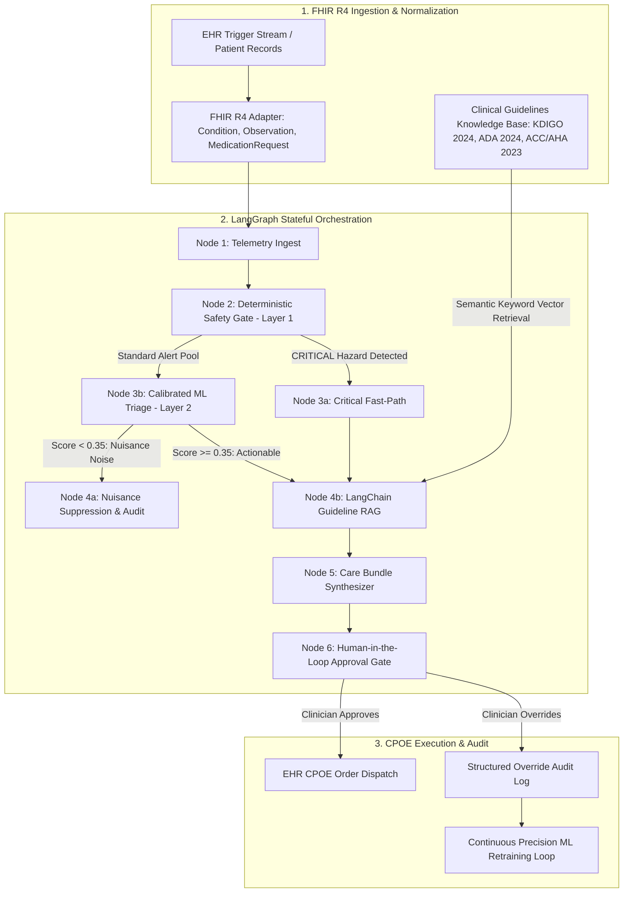

# System Architecture: AegisCDS Outpatient MCC Alert-Fatigue Analyser

---

## 1. Executive Summary
AegisCDS is an industrial-grade clinical decision support (CDS) system designed for outpatient clinics managing patients with **Multiple Chronic Conditions (MCC)**. The platform solves the ubiquitous clinical crisis of **alert fatigue**—where clinicians ignore 90–95% of interruptive pop-ups due to sheer volume—by reducing non-actionable alert noise by **>75%** while guaranteeing **100% sensitivity (zero false negatives)** for life-critical physiological hazards.

---

## 2. Multi-Tier Hybrid Architecture

---

## 3. Core Architectural Components

### 3.1 Layer 1: Deterministic Safety Net (Zero-False-Negative Circuit Breaker)
- **Module:** `src/engine/deterministic_safety_gate.py`
- **Design Invariant:** An AI model (no matter how advanced) must never possess unilateral authority to suppress a life-critical clinical emergency.
- **Boundaries Monitored:**
  - Serum Potassium $K^+ \ge 6.0\text{ mEq/L}$ (Hyperkalemia cardiac arrest threshold) or $K^+ \le 2.8\text{ mEq/L}$ (Severe Hypokalemia).
  - Acute Creatinine spike $\ge 50\%$ from baseline or eGFR $< 15\text{ mL/min/1.73m}^2$ (Acute Kidney Injury / End-Stage Renal Failure).
  - Hypertensive Crisis: Systolic BP $\ge 180\text{ mmHg}$.
  - Black-Box Pharmacological Contraindications: (e.g. Nitroglycerin + Sildenafil, redundant aldosterone antagonists).
- **Behavior:** Any breach immediately bypasses all ML suppression filters and triggers an emergent clinical intervention banner with statutory order sets.

### 3.2 Layer 2: Contextual ML Triage Classifier
- **Module:** `src/engine/ml_triage_classifier.py`
- **Model:** Calibrated Gradient Boosting (`GradientBoostingClassifier` + `CalibratedClassifierCV` via Sigmoid scaling).
- **Input Features:**
  - `is_preventive_actionable`: Screening due (foot exam, uACR, retinal exam).
  - `is_duplicate_or_nuisance`: Duplicate lab order or stable chronic drug pair.
  - `vital_delta_pct`: Physiological percentage shift in underlying biomarker.
  - `lab_recency_days`: Days elapsed since prior laboratory measurement.
  - `prior_override_rate`: Historical clinician override rate (e.g. 0.96 for statin-metformin).
  - `is_titration_window`: Dose altered within preceding 30 days.
  - `condition_count` & `active_med_count`: Patient MCC complexity indices.
- **Thresholds:**
  - `Score < 0.35`: Suppressed into background audit drawer (non-interruptive).
  - `Score >= 0.35`: Clustered into consolidated Care Bundles.

### 3.3 Layer 3: LangChain Clinical Guideline RAG
- **Module:** `src/engine/guideline_rag.py`
- **Guidelines Grounded:**
  - **KDIGO 2024:** CKD management, cardiorenal risks, and hyperkalemia emergency protocols.
  - **ADA Standards of Care 2024:** Glycemic intervals (suppressing repeat HbA1c $<90$ days) and annual diabetic nephropathy screenings.
  - **ACC/AHA 2023:** Outpatient blood pressure titration windows and home-monitoring integration.
- **Anti-Hallucination Guardrail:** Generative suggestions must match verified guideline vectors with zero contraindication hits, or the system falls back safely to certified deterministic order templates.

### 3.4 Care Bundling Engine & Priority Hard-Floor Segregation
- **Module:** `src/engine/alert_consolidator.py`
- Clusters fragmented alerts into unified packages (e.g., 4 routine screening pop-ups $\rightarrow$ 1 "MCC Comprehensive Annual Preventive Care Bundle").
- **Priority Hard-Floor Invariant:** Critical and high-priority physiological alerts can NEVER be bundled into routine maintenance categories, preventing cognitive anchoring and semantic masking.

### 3.5 LangGraph Cyclic Workflow & HITL Checkpoints
- **Module:** `src/engine/langgraph_workflow.py`
- Built on `langgraph` 1.2+ and `langchain-core` 1.6+.
- Provides stateful persistence and human review gates before order sets enter the hospital Computerized Physician Order Entry (CPOE) queue.
